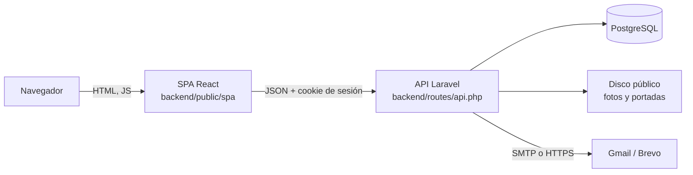
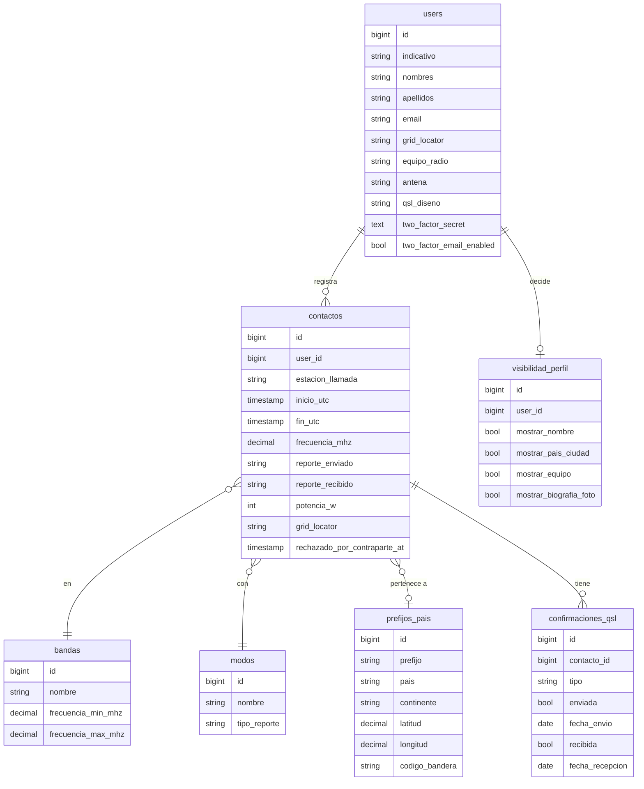

# Libro de Guardia

**Sistema web para el registro de contactos de radioafición y la confirmación de QSL**

| | |
|---|---|
| **Institución** | Universidad Estatal de Bolívar (Ecuador) |
| **Carrera** | Software |
| **Año** | 2026 |
| **Equipo** | [xkdemxn](https://github.com/xkdemxn) · [juanpcoba-wq](https://github.com/juanpcoba-wq) · [emilyvelasco-art](https://github.com/emilyvelasco-art) · [Dorian1741](https://github.com/Dorian1741) · [sergio3200x](https://github.com/sergio3200x) |

---

## Índice

1. [Resumen](#1-resumen)
2. [Contexto del problema](#2-contexto-del-problema)
3. [Objetivos](#3-objetivos)
4. [Alcance: historias de usuario](#4-alcance-historias-de-usuario)
5. [Innovaciones](#5-innovaciones)
6. [Arquitectura](#6-arquitectura)
7. [Modelo de datos](#7-modelo-de-datos)
8. [Reglas de negocio](#8-reglas-de-negocio)
9. [API REST](#9-api-rest)
10. [Seguridad y privacidad](#10-seguridad-y-privacidad)
11. [Internacionalización](#11-internacionalización)
12. [Estructura del repositorio](#12-estructura-del-repositorio)
13. [Instalación en desarrollo](#13-instalación-en-desarrollo)
14. [Configuración del correo](#14-configuración-del-correo)
15. [Despliegue en producción](#15-despliegue-en-producción)
16. [Limitaciones y trabajo futuro](#16-limitaciones-y-trabajo-futuro)

---

## 1. Resumen

Libro de Guardia es una aplicación web que reemplaza el cuaderno de papel en el que los radioaficionados anotan cada comunicado (QSO). Cada operador lleva su propio libro: registra contactos, gestiona sus confirmaciones QSL, importa y exporta en el formato estándar ADIF, genera tarjetas QSL digitales y consulta estadísticas con un mapa de sus contactos.

Además de las historias de usuario planteadas, el sistema añade cuatro innovaciones propias. La principal es la **confirmación automática entre operadores**: si las dos estaciones de un comunicado usan el sistema y lo registran, el contacto queda confirmado para ambas sin enviar tarjetas.

El backend es una API REST en **Laravel 13** sobre **PostgreSQL**. La interfaz es una SPA en **React 19** con TypeScript, disponible en español, inglés y portugués.

## 2. Contexto del problema

En radioafición, cada estación debe llevar un **libro de guardia** (*logbook*) con los datos de cada comunicado: estación contactada, fecha y hora en UTC, frecuencia, banda, modo de emisión y reportes de señal intercambiados.

Para demostrar que un comunicado ocurrió, las dos estaciones intercambian una **confirmación QSL**. Tradicionalmente es una tarjeta postal; hoy también existen servicios electrónicos como eQSL y LoTW (*Logbook of The World*, de la ARRL). Los contactos confirmados cuentan para diplomas internacionales como el **DXCC** (100 países) o el **WAC** (los seis continentes).

Llevar el libro en papel o en hojas de cálculo provoca errores de formato y duplicados, y hace muy laborioso el seguimiento de las confirmaciones. Libro de Guardia valida cada dato al registrarlo, detecta duplicados, automatiza las confirmaciones entre usuarios y se integra con otros programas mediante ADIF.

## 3. Objetivos

### Objetivo general

Desarrollar una aplicación web que permita a los radioaficionados registrar, consultar y confirmar sus comunicados de forma confiable, siguiendo los estándares de la actividad.

### Objetivos específicos

- Registrar contactos con validación de indicativo, frecuencia según la banda y reporte según el modo.
- Gestionar el estado de las confirmaciones QSL por cada medio (tarjeta, eQSL, LoTW, interna).
- Intercambiar datos con otros programas de radioafición mediante importación y exportación ADIF, además de CSV y PDF.
- Automatizar la confirmación de contactos entre operadores que usan el sistema.
- Ofrecer estadísticas, un mapa de contactos y el progreso hacia diplomas.
- Proteger las cuentas con verificación en dos pasos y respetar la privacidad del perfil de cada operador.

## 4. Alcance: historias de usuario

| Código | Historia | Dónde se resuelve |
|---|---|---|
| US-01 | Registro de un operador con su indicativo | `Api/Auth/RegistroController` |
| US-02 | Inicio de sesión con indicativo o correo | `Api/Auth/SesionController` |
| US-03 | Registrar un contacto | `Api/ContactoController`, `ContactoRequest` |
| US-04 | Formulario de contacto compartido (crear y editar) | `frontend/src/paginas/contactos` |
| US-05 | Validación de los datos del contacto | `ContactoRequest` |
| US-06 | Listado paginado del libro con búsqueda | `Api/ContactoController@index` |
| US-07 | Corregir un contacto | `Api/ContactoController@update` |
| US-08 | Eliminar un contacto con confirmación previa | `Api/ContactoController@destroy` |
| US-09 | Filtros por fechas, banda, modo, QSL e indicativo | `FiltroContactosRequest` |
| US-10 | Estado QSL por medio, enviada y recibida por separado | `Api/ConfirmacionQslController` |
| US-11 | Exportar el libro a CSV (compatible con Excel) | `Services/ExportadorCsv` |
| US-12 | Exportar el libro a ADIF 3.1.4 | `Services/ExportadorAdif` |
| US-13 | Editar «Mi perfil»: datos, estación, fotos y privacidad | `Api/PerfilController` |
| US-14 | Importar contactos desde un archivo ADIF | `Services/ImportadorAdif`, `Api/ImportacionController` |
| US-15 | Perfil público de un operador | `Api/PerfilPublicoController` |
| US-16 | Estadísticas del operador | `Api/EstadisticasController` |
| US-18 | Restablecer la contraseña por correo | `Api/Auth/EnlaceRestablecimientoController` |

Funcionalidades adicionales:

- **Reporte PDF** del libro con resumen por rango (HF/VHF/UHF), banda y modo (`Services/ReportePdf`).
- **Tarjeta QSL digital**: se genera como SVG, se descarga en PNG o SVG o se envía por correo como adjunto. Tiene cuatro diseños y permite personalizar la foto, su opacidad y el mensaje.
- **Consulta pública de una QSL**: quien recibe una tarjeta puede comprobar, sin cuenta, que el contacto existe, con el número de QSO y el indicativo.
- **Páginas informativas**: «¿Qué es una QSL?», «Sobre nosotros» y «Privacidad».
- **Tema claro y oscuro** y reloj UTC siempre visible.

## 5. Innovaciones

### Innovación 1: confirmación QSL automática

Cuando dos operadores del sistema registran el mismo comunicado (indicativos cruzados, misma banda y mismo modo, con una diferencia de hasta **15 minutos**), ambos contactos quedan confirmados automáticamente con una QSL de tipo *interna*. Funciona como LoTW, pero sin trámites (`Services/ConfirmadorQsl`).

Se amplía con las **solicitudes de confirmación**. Si otra estación anotó un contacto contigo y tú no lo tienes, te llega una solicitud:

- **Aceptar** copia el contacto a tu libro, visto desde tu lado, y lo confirma para ambos.
- **Rechazar** («no fui yo») la descarta, y la otra estación lo ve en el detalle de su contacto.

### Innovación 2: mapa de contactos

Las estadísticas incluyen un mapa (Leaflet) con la ubicación de cada estación contactada. La posición se obtiene del *grid locator* Maidenhead (`Services/Maidenhead`) o, si no lo hay, del país del prefijo. Los contactos cercanos se agrupan para no superponer cientos de marcadores.

### Innovación 3: ficha rápida del indicativo

Al escribir un indicativo en el formulario de contacto aparece una ficha con el país (y su bandera) y los contactos anteriores con esa estación. Si la estación es usuaria del sistema, la ficha muestra también los datos que esa persona decidió hacer públicos (`Api/FichaIndicativoController`).

### Innovación 4: progreso hacia diplomas

Las estadísticas muestran el avance hacia el **DXCC** (100 países confirmados) y el **WAC** (seis continentes), además de las zonas de radioaficionados de Ecuador trabajadas.

## 6. Arquitectura

El repositorio tiene dos proyectos independientes: **`backend/`** (API en Laravel) y **`frontend/`** (SPA en React). En producción se sirven desde un **único dominio**: el frontend se compila dentro de `backend/public/spa`, y Laravel entrega esa SPA y la API bajo `/api`. La sesión de la SPA usa cookies de Laravel Sanctum, sin tokens en el navegador.



### Tecnologías

| Capa | Tecnología |
|---|---|
| Lenguaje del backend | PHP 8.4 |
| Framework | Laravel 13 |
| Autenticación | Laravel Sanctum 4 (sesión SPA) y Laravel Fortify (verificación en dos pasos TOTP) |
| Base de datos | PostgreSQL |
| PDF | barryvdh/laravel-dompdf |
| Frontend | React 19, TypeScript 5.9, React Router 7 |
| Estado del servidor | TanStack Query 5 y Axios |
| Estilos | Tailwind CSS 3 |
| Mapas | Leaflet |
| Traducciones | i18next / react-i18next |
| Compilación | Vite 8 |
| Correo | SMTP (Gmail) o API de Brevo (transporte propio `Mail/BrevoTransport`) |

### Organización del backend

Todas las rutas de esta lista están dentro de `backend/`.

- **Controladores** (`app/Http/Controllers/Api`): uno por recurso o acción, delgados.
- **Form Requests** (`app/Http/Requests`): toda la validación de entrada.
- **Servicios** (`app/Services`): la lógica de dominio (confirmación QSL, ADIF, CSV, PDF, Maidenhead, segundo factor).
- **API Resources** (`app/Http/Resources`): el formato JSON de las respuestas.
- **Enums** (`app/Enums`): tipo de reporte (RS, RST, dB), tipo de QSL y zonas de Ecuador.

## 7. Modelo de datos



Los catálogos (`bandas`, `modos`, `prefijos_pais`) se cargan con seeders: 16 bandas, 11 modos y 352 prefijos de país.

## 8. Reglas de negocio

- **Indicativo**: se normaliza a mayúsculas y se identifica su país por el prefijo más largo que coincida. Los sufijos de operación (`/P` portátil, `/M` móvil, `/MM` marítimo…) no cambian el país.
- **Frecuencia y banda**: la frecuencia debe caer dentro del rango de una banda de radioaficionados, y la banda se asigna automáticamente.
- **Reporte de señal según el modo**: RS para fonía, RST para telegrafía y dB para modos digitales como FT8.
- **Fechas**: todas las horas se guardan y se muestran en UTC, y el fin del contacto no puede ser anterior al inicio.
- **Duplicados**: un contacto con la misma estación, banda y modo a menos de **10 minutos** de otro se señala como posible duplicado.
- **Confirmación QSL**: enviada y recibida se marcan por separado para cada medio.
- **Importación ADIF**: se hace en dos pasos (vista previa y confirmación), con las mismas validaciones que el formulario. Los duplicados y las filas con errores se informan y se omiten.
- **Tarjeta por correo**: solo se puede enviar desde una cuenta con el correo verificado.

## 9. API REST

Todas las rutas están en `backend/routes/api.php`, bajo el prefijo `/api`, y responden en JSON. Las marcadas con 🔒 requieren sesión.

### Autenticación y cuenta

| Método | Ruta | Descripción |
|---|---|---|
| POST | `/registro` | Crear una cuenta |
| POST | `/sesion` | Iniciar sesión (indicativo o correo) |
| DELETE | `/sesion` | Cerrar sesión |
| GET / POST | `/segundo-factor/desafio` | Ver y resolver el desafío de dos pasos |
| POST | `/segundo-factor/desafio/correo` | Enviar un código por correo |
| POST | `/contrasena/enlace` | Pedir el enlace de restablecimiento |
| POST | `/contrasena/restablecer` | Cambiar la contraseña con el enlace |
| GET 🔒 | `/usuario` | Usuario con la sesión iniciada |
| PUT 🔒 | `/contrasena` | Cambiar la contraseña |
| POST 🔒 | `/correo/verificacion` | Reenviar la verificación de correo |
| POST 🔒 | `/segundo-factor/configuracion` | Activar o desactivar la app autenticadora o el correo |
| POST 🔒 | `/segundo-factor/configuracion/confirmar` | Confirmar la app autenticadora |

### Libro de guardia 🔒

| Método | Ruta | Descripción |
|---|---|---|
| GET | `/contactos` | Listado paginado con filtros |
| POST | `/contactos` | Registrar un contacto |
| GET / PUT / DELETE | `/contactos/{id}` | Ver, corregir o eliminar |
| PUT | `/contactos/{id}/qsl` | Estado QSL del contacto |
| GET | `/contactos/ficha` | Ficha rápida de un indicativo |
| POST | `/contactos/exportar` | Exportar a CSV, ADIF o PDF |
| POST | `/importaciones` | Subir un ADIF y obtener la vista previa |
| GET / DELETE | `/importaciones/pendiente` | Ver o cancelar la importación pendiente |
| POST | `/importaciones/pendiente/confirmar` | Confirmar la importación |
| GET | `/contactos/{id}/tarjeta`, `/tarjeta.svg` | Tarjeta QSL (vista previa y SVG) |
| POST | `/contactos/{id}/tarjeta/enviar` | Enviar la tarjeta por correo |
| PATCH | `/tarjeta-qsl` | Personalizar el diseño de las tarjetas |
| GET | `/solicitudes` | Solicitudes de confirmación pendientes |
| POST | `/solicitudes/{id}/aceptar`, `/rechazar` | Responder una solicitud |
| GET | `/estadisticas` | Estadísticas, mapa y diplomas |
| GET / PATCH / DELETE | `/perfil` | Ver, editar o eliminar la cuenta |
| GET | `/catalogos`, `/ubicaciones` | Bandas, modos, países y provincias |

### Públicas

| Método | Ruta | Descripción |
|---|---|---|
| GET | `/indicativos/{indicativo}` | Perfil público de un operador |
| GET | `/qsl/verificar` | Consulta pública de una QSL |
| GET | `/prefijos` | Prefijos de país por continente |

## 10. Seguridad y privacidad

- **Sesión SPA con Sanctum**: cookies `HttpOnly` y protección CSRF. El navegador no guarda tokens.
- **Verificación en dos pasos** con dos métodos: app autenticadora (TOTP con código QR) y código por correo. Incluye códigos de recuperación de un solo uso. El QR pendiente vence a los 10 minutos y el código por correo a los 5.
- **Límites de intentos** (*rate limiting*) en el inicio de sesión, el restablecimiento de contraseña, la verificación de correo, el segundo factor, la consulta pública de QSL y el envío de tarjetas.
- **Consulta pública de QSL**: exige el número de QSO y el indicativo a la vez, y responde igual si no coinciden o si el QSO no existe, para que no se puedan recorrer libros ajenos.
- **Privacidad del perfil**: cada operador decide si se muestran su nombre, su ubicación, su equipo y su biografía con foto. Por defecto el equipo está oculto.
- **Restablecimiento de contraseña**: la respuesta es la misma exista o no la cuenta.
- **Eliminación de cuenta**: borra también los contactos y las imágenes del operador.

## 11. Internacionalización

- **Interfaz**: español (predeterminado), inglés y portugués de Brasil, con i18next. El script `npm run i18n:revisar`, ejecutado en `frontend/`, comprueba que no falten traducciones.
- **API**: el middleware `EstablecerIdioma` responde en el idioma de la cabecera `Accept-Language`, incluidos los mensajes de validación (`backend/lang/`).

## 12. Estructura del repositorio

```
backend/                  API en Laravel
  app/
    Console/Commands/     comando correo:probar
    Enums/                TipoReporte, TipoQsl, ZonaEcuador
    Http/Controllers/Api/ controladores de la API
    Http/Requests/        validación de entrada
    Http/Resources/       formato JSON de las respuestas
    Mail/                 tarjeta QSL por correo y transporte de Brevo
    Models/               User, Contacto, ConfirmacionQsl, Banda, Modo, PrefijoPais, VisibilidadPerfil
    Services/             lógica de dominio
  database/
    migrations/           esquema de la base de datos
    seeders/              catálogos y datos de demostración
  public/                 raíz del servidor web
    spa/                  SPA compilada (la genera el build de frontend/)
  routes/
    api.php               API REST
    web.php               enlace de verificación de correo y entrega de la SPA
frontend/                 SPA en React
  src/paginas/            pantallas (auth, contactos, perfil, público, informativas)
  src/componentes/        componentes reutilizables
  src/layouts/            plantillas de invitado, pública y con sesión
  src/i18n/               traducciones (en, pt)
  vite.config.ts          servidor de desarrollo y salida del build
README.md                 este informe
DESPLIEGUE.md             guía de despliegue en Debian
```

## 13. Instalación en desarrollo

**Requisitos**: PHP 8.4 con las extensiones `pdo_pgsql` y `bcmath`, Composer, PostgreSQL y Node.js 22 o superior.

**Backend**:

```sh
cd backend
composer install
cp .env.example .env
php artisan key:generate
```

Configura `APP_URL` y las variables `DB_*` en `backend/.env`. Después:

```sh
php artisan migrate
php artisan db:seed     # catálogos y operadores de demostración
php artisan storage:link
```

**Frontend**:

```sh
cd frontend
npm install
```

**Arrancar los dos**: desde `backend/`, ejecuta `composer run dev`. Este comando levanta Laravel en el puerto 8000 y Vite en el 5173. También puedes arrancarlos por separado, con `php artisan serve` en `backend/` y `npm run dev` en `frontend/`.

En desarrollo se abre `http://localhost:5173`. Vite reenvía `/api`, `/sanctum` y `/storage` a Laravel, así que el navegador ve un solo origen.

**Cuentas de demostración** (solo se crean fuera de producción):

| Indicativo | Contraseña | Contenido |
|---|---|---|
| `HC1QRC` | `password` | 60 contactos, 20 con QSL recibida |
| `LU4BB` | `password` | Comparte un QSO con HC1QRC, confirmado automáticamente |

## 14. Configuración del correo

El correo se usa para verificar direcciones, restablecer contraseñas, enviar el código del segundo factor y enviar tarjetas QSL. Con `MAIL_MAILER=log` los correos solo se escriben en el log, y el segundo factor por correo queda deshabilitado.

El correo se configura en `backend/.env`. Para comprobar la configuración enviando un correo real, desde `backend/`:

```sh
php artisan config:clear
php artisan correo:probar destinatario@ejemplo.com
```

### Opción A: Gmail (SMTP)

```dotenv
MAIL_MAILER=smtp
MAIL_SCHEME=smtps
MAIL_HOST=smtp.gmail.com
MAIL_PORT=465
MAIL_USERNAME=tu-correo@gmail.com
MAIL_PASSWORD="xxxx xxxx xxxx xxxx"
MAIL_FROM_ADDRESS=tu-correo@gmail.com
MAIL_FROM_NAME="Libro de Guardia"
```

`MAIL_PASSWORD` debe ser una [contraseña de aplicación](https://myaccount.google.com/apppasswords), que requiere tener activa la verificación en dos pasos de Google. No uses la contraseña normal de la cuenta. Como lleva espacios, **escríbela entre comillas**.

### Opción B: Brevo (API HTTPS)

```dotenv
MAIL_MAILER=brevo
BREVO_API_KEY=tu_clave_de_api
MAIL_FROM_ADDRESS=remitente@tu-dominio.com
MAIL_FROM_NAME="Libro de Guardia"
```

Usa una clave de API (no una clave SMTP) y un remitente autorizado en Brevo. Que Brevo acepte un envío no garantiza que llegue a la bandeja de entrada: revisa también la carpeta de spam y los registros de Brevo.

## 15. Despliegue en producción

La guía paso a paso para un servidor Debian con Nginx, PHP-FPM, PostgreSQL y HTTPS está en [DESPLIEGUE.md](DESPLIEGUE.md). En resumen, en el `backend/.env` del servidor:

```dotenv
APP_ENV=production
APP_DEBUG=false
APP_URL=https://tu-dominio.com
FRONTEND_URL=https://tu-dominio.com
LOG_LEVEL=warning
SESSION_SECURE_COOKIE=true
```

Configura también las variables `DB_*` y el correo (sección 14). `APP_URL` debe coincidir **exactamente** con la dirección pública, porque es el dominio que Sanctum acepta para la sesión de la SPA.

```sh
cd backend
composer install --no-dev --optimize-autoloader
php artisan key:generate        # solo la primera vez
php artisan migrate --force
php artisan db:seed --force     # en producción solo carga bandas, modos y prefijos
php artisan storage:link

cd ../frontend
npm ci && npm run build         # compila dentro de backend/public/spa

cd ../backend
php artisan optimize
```

- El servidor web debe apuntar a la carpeta `backend/public/`.
- PHP necesita permiso de escritura en `backend/storage/` y `backend/bootstrap/cache/`.
- La aplicación confía en el proxy (`trustProxies`), así que funciona detrás de un túnel o de un balanceador con HTTPS.
- No necesita workers de cola ni tareas programadas.
- Después de cada actualización, repite `composer install`, `migrate --force`, `npm run build` y `php artisan optimize`.

## 16. Limitaciones y trabajo futuro

- **Sin pruebas automatizadas**: el proyecto tuvo una suite PHPUnit (unas 250 pruebas de la API), retirada antes del despliegue. Sigue disponible en el historial de git y conviene recuperarla para detectar regresiones.
- **Sin sincronización con servicios externos**: los estados de eQSL y LoTW se marcan a mano; una mejora natural es conectarse a sus API.
- **Diplomas**: solo se calculan el DXCC y el WAC; se podrían añadir el WAS, el IOTA u otros.
- **Catálogo de prefijos**: es una tabla estática, no la lista DXCC completa con sus entidades especiales.
- **Almacenamiento de imágenes**: usa el disco local; en un servidor con varias instancias convendría un almacenamiento compartido (S3 o similar).
